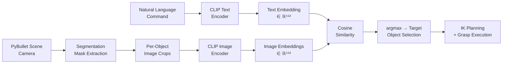
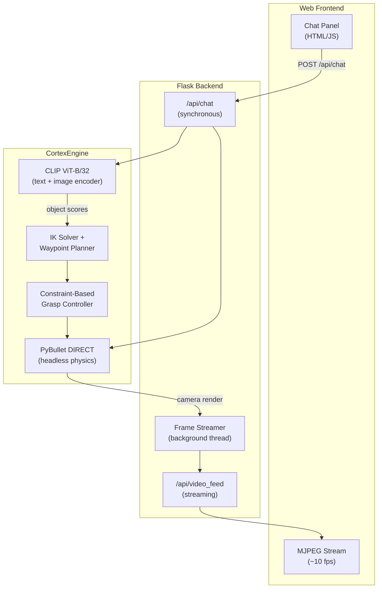

<div align="center">

# CortexSort

### Vision-Language Model Guided Robotic Manipulation with Zero-Shot Object Grounding

[](https://www.python.org/)
[](https://pytorch.org/)
[](https://openai.com/research/clip)
[](https://pybullet.org/)
[](https://flask.palletsprojects.com/)

*Can a pre-trained Vision-Language Model ground free-form language into physical robot actions — without any task-specific fine-tuning?*

</div>

<p align="center">
  
  <br>
  <em><b>End-to-End VLM Pipeline</b>: (1) User issues natural-language command → (2) CLIP ViT-B/32 computes text–image embeddings over segmented object crops → (3) Highest cosine-similarity object is selected → (4) Panda arm executes constraint-based grasp and zone placement</em>
</p>

For full video in mp4 :[Watch VLM in Action](https://github.com/nirbhayborikar/CortexSort/blob/main/media/vlm.mp4)
---

## Abstract

**CortexSort** investigates the use of pre-trained Vision-Language Models (VLMs) as zero-shot perception modules for robotic manipulation. We integrate [CLIP ViT-B/32](https://arxiv.org/abs/2103.00020) into a closed-loop pipeline where free-form natural language is grounded to physical objects via text–image embedding alignment, and a Franka Emika Panda 7-DOF arm executes the inferred pick-and-place task in a PyBullet physics simulation.

The key insight is that CLIP's contrastive pre-training on 400M image–text pairs provides a sufficiently rich shared embedding space to bridge the *language→perception→action* gap — no task-specific fine-tuning, object detection training, or predefined label sets are required. The system achieves reliable object grounding across diverse phrasings (e.g., *"pick the red cube"*, *"grab something blue"*, *"move the cylinder to the green zone"*) using only cosine similarity in the CLIP embedding space.

---

## Method

### 1. Vision-Language Grounding

We formulate object selection as a **text-conditioned image retrieval** problem over segmented scene crops:



1. **Scene Capture** — PyBullet renders an 800×480 RGB image with per-pixel segmentation masks via `getCameraImage()` with the TinyRenderer backend.
2. **Object Isolation** — Each object's segmentation mask produces a tight bounding-box crop with white background fill, eliminating inter-object visual interference.
3. **Embedding Alignment** — CLIP encodes the user's text prompt and all object crops into a shared 512-dimensional embedding space. Object selection is the `argmax` over cosine similarities.
4. **Action Execution** — The selected object's 3D pose (from PyBullet) is passed to an inverse kinematics solver, and the Panda arm executes a constraint-based grasp with waypoint-safe trajectories.

### 2. Constraint-Based Grasping

Rather than relying on friction-only grasps (which are unreliable in headless physics simulation), we implement a **fixed-constraint grasp** strategy:

- After gripper closure, a `JOINT_FIXED` constraint attaches the target object to the end-effector link in the relative frame computed at grasp time.
- A **grip verification** step confirms the object z-position increased after lifting — if not, the constraint is removed and the pick is reported as failed.
- On release, the constraint is destroyed and the gripper opens, allowing natural placement under gravity.

This approach achieves reliable grasping across all workspace positions, including zone-to-zone cross-basket transfers at the edges of the kinematic workspace.

### 3. Robotic Control

| Component | Details |
|:---|:---|
| **Manipulator** | Franka Emika Panda — 7-DOF, position-controlled, fixed base |
| **IK Solver** | PyBullet `calculateInverseKinematics` on end-effector link 11 |
| **Trajectory Safety** | Waypoint-based movement with configurable minimum height (default 0.9m) to prevent table collisions during horizontal transit |
| **Gripper** | Two-finger position-controlled gripper (0.04m open, 0.0m closed) with 200N force, augmented by fixed-constraint attachment |

---

## Features

| Capability | Description |
|:---|:---|
| **Zero-Shot Object Selection** | CLIP matches arbitrary text to scene objects — no predefined labels or fine-tuning |
| **Cross-Zone Transfer** | *"pick cube from yellow basket and put in green basket"* — locates objects in source zone, transfers to destination |
| **Auto Color Sorting** | *"sort all objects by color"* — sequential pick-and-place of all objects into color-matched zones |
| **Interactive Web UI** | Split-panel: ChatGPT-style chat (left) + live MJPEG simulation stream (right) |
| **Multi-Angle Camera** | 5 presets (default, top, front, right, isometric) switchable via UI or chat |
| **Grip Verification** | Constraint-based grasping with post-lift z-position validation |

### Example Commands

```
pick the red cube                                    # zero-shot CLIP matching
grab something blue                                  # fuzzy language grounding
pick yellow cylinder and place in green zone          # explicit zone override
pick cube from red basket and put in blue basket      # cross-zone transfer
sort all objects by color                             # autonomous full-scene sorting
go home                                              # return to home configuration
stop                                                 # emergency stop + grasp release
```

---

## Installation

```bash
git clone https://github.com/nirbhayborikar/CortexSort.git
cd CortexSort
python3 -m venv .venv && source .venv/bin/activate
pip install -r requirements.txt
```

> CLIP model weights (~2 GB) are downloaded automatically on first run.

## Usage

### Web UI (recommended)

```bash
python3 app.py
# → http://localhost:5000
```

### Terminal CLI

```bash
python3 cortex_cli.py
```

---

## Architecture

```
CortexSort/
├── cortex_engine.py        # Core: PyBullet sim + CLIP inference + robot control
├── app.py                  # Flask server: chat API, MJPEG stream, command parser
├── cortex_cli.py           # Terminal-based interactive interface
├── demo_pick_place.py      # Minimal pick-and-place demo (no VLM)
├── templates/
│   └── index.html          # Split-panel web UI
├── static/
│   └── style.css           # Dark-theme styling
├── media/                  # Demo videos and GIFs
├── requirements.txt
└── README.md
```

### System Design



- **Thread Safety**: A single `threading.Lock` serializes all PyBullet access between the chat handler and the frame-capture thread.
- **Live Updates**: A `frame_callback` mechanism pushes new frames during long-running robot actions (every 24 physics steps), so the MJPEG stream stays responsive even during multi-second pick-and-place operations.

---

## Scene Configuration

| Element | Specification |
|:---|:---|
| **Objects** | 5 primitives: red cube, red sphere, blue cube, green sphere, yellow cylinder (5cm, 100g each) |
| **Sorting Zones** | 4 color zones (15cm × 15cm × 2cm) with 3cm visual borders at table corners |
| **Table Surface** | Z = 0.65m, standard PyBullet table URDF |
| **Camera** | 800 × 480 resolution, TinyRenderer backend, 5 preset viewpoints |

---

## Technical Details

### CLIP Inference

```python
# Per-object segmentation mask → tight crop → CLIP embedding
scores = sim.compute_object_similarity(crops, "red cube")
# → {'red_cube': 0.41, 'red_sphere': 0.23, 'blue_cube': 0.18, ...}

selected, confidence = sim.select_best_object(scores)
# → ('red_cube', 0.41)
```

All object crops and the text prompt are encoded in a **single forward pass** through CLIP, making inference efficient even as the number of scene objects grows.

### VLM Embedding Space Analysis

The system exploits the structure of CLIP's joint embedding space:
- **Color grounding**: *"red"* clusters with red-colored object crops in embedding space
- **Shape grounding**: *"cube"* vs. *"sphere"* produce discriminative embeddings even for same-color objects
- **Compositional grounding**: *"red cube"* correctly disambiguates from *"red sphere"* through embedding composition

This zero-shot generalization comes from CLIP's contrastive pre-training objective, which aligns visual and textual representations without requiring task-specific supervision.

---

## Requirements

- Python 3.10+
- NVIDIA GPU recommended (CLIP runs on CPU but is slower)
- ~2 GB disk for CLIP ViT-B/32 model weights
- Tested on NVIDIA Jetson AGX Orin (JetPack 6.x) and Ubuntu 22.04

---

## Future Directions

- **VLM Scaling**: Replace CLIP ViT-B/32 with larger VLMs (SigLIP, BLIP-2, PaLI) for improved spatial and relational reasoning
- **Fine-Tuning**: Domain-adaptive fine-tuning on robotic manipulation crops to improve in-distribution grounding accuracy
- **Multi-Step Planning**: LLM-based task decomposition for complex instructions (*"stack all cubes, then put the sphere on top"*)
- **Speech Interface**: Whisper-based speech-to-text for hands-free voice commands
- **Sim-to-Real Transfer**: Deploy learned VLM grounding policies on physical Franka hardware via domain randomization

---

## Citation

```bibtex
@misc{cortexsort2026,
  title   = {CortexSort: Vision-Language Model Guided Robotic Manipulation with Zero-Shot Object Grounding},
  author  = {Nirbhay Borikar},
  year    = {2026},
  url     = {https://github.com/nirbhayborikar/CortexSort}
}
```

---

<div align="center">
<sub>Built with PyBullet · CLIP · PyTorch · Flask</sub>
</div>
