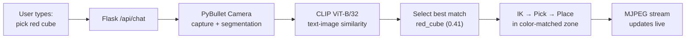

# CortexSort

### Chat-Driven Robotic Manipulation with Zero-Shot Vision-Language Matching

[](https://www.python.org/)
[](https://pybullet.org/)
[](https://openai.com/research/clip)
[](https://flask.palletsprojects.com/)

> Type **"pick the red cube"** in a chat window — watch the robot do it in real time.

---

## What This Does

CortexSort pairs a **Franka Panda robot arm** (simulated in PyBullet) with **OpenAI CLIP** for zero-shot object selection. You describe what you want in natural language, CLIP matches your text to camera crops of each object, and the robot picks the best match and sorts it into a color zone.

Two ways to use it:

| Mode | Command | Interface |
|:---|:---|:---|
| **Web UI** | `python3 app.py` | Split-screen: chat on left, live sim on right |
| **Terminal** | `python3 cortex_cli.py` | Classic `input()` prompt in the terminal |

---

## Web UI

```
┌─────────────────────────┬──────────────────────────────┐
│  Chat Window            │  Live Simulation             │
│                         │                              │
│  You: pick red cube     │  ┌────────────────────────┐  │
│  Bot: CLIP scores:      │  │                        │  │
│    red_cube     0.41 ██ │  │   [PyBullet camera     │  │
│    blue_cube    0.18 █  │  │    MJPEG stream at     │  │
│    ...                  │  │    ~10 fps]             │  │
│  Selected red_cube      │  │                        │  │
│  Placed in Red Zone.    │  └────────────────────────┘  │
│                         │                              │
│  [___Type here___] Send │  PyBullet · Panda · CLIP     │
└─────────────────────────┴──────────────────────────────┘
```

### Example Commands

- `pick the red cube` — CLIP matches "red cube" across all 5 objects
- `grab something blue` — fuzzy matching works
- `pick yellow cylinder and place in green zone` — explicit zone override
- `sort all objects by color` — auto-sorts everything into matching zones
- `throw the green sphere` — picks and tosses it

---

## Quick Start

```bash
git clone https://github.com/nirbhayborikar/CortexSort.git
cd CortexSort
python3 -m venv .venv && source .venv/bin/activate
pip install -r requirements.txt
```

### Run the Web UI

```bash
python3 app.py # live simulation window with chatbot in left like "chatgpt"
# Open http://localhost:5000 in your browser
# http://192.168.178.25:5000 in your browser
# fuser -k 5000/tcp #Run this to kill it and free the port: 
```

### Run the Terminal CLI (no browser needed)

```bash
python3 cortex_cli.py # when from terminal interaction needed
```

---

## How It Works



1. **Capture** — PyBullet renders an 800x480 camera image with per-pixel segmentation masks
2. **Crop** — Each object is isolated using its segmentation mask (white background, tight bbox)
3. **Match** — CLIP computes cosine similarity between the text prompt and each object crop
4. **Act** — The Panda arm uses inverse kinematics to pick the highest-scoring object and place it in the appropriate zone
5. **Stream** — A background thread pushes JPEG frames at ~10 fps to the browser via MJPEG

---

## Project Structure

```
CortexSort/
├── app.py                  # Flask web server (chat API + MJPEG stream)
├── cortex_engine.py        # PyBullet simulation + CLIP model (core class)
├── cortex_cli.py           # Terminal-based interactive demo
├── demo_pick_place.py      # Minimal pick-and-place without CLIP
├── templates/
│   └── index.html          # Split-panel chat + sim UI
├── static/
│   └── style.css           # Dark-theme styling
├── media/                  # Demo videos and screenshots
├── requirements.txt
└── README.md
```

---

## Scene Setup

The simulation creates:

- **5 objects**: red cube, red sphere, blue cube, green sphere, yellow cylinder
- **4 color zones**: red (left-front), blue (left-back), green (right-front), yellow (right-back) — each with 3cm borders
- **Franka Panda** 7-DOF arm with two-finger gripper, fixed base on table

All objects are 5cm, 100g, sitting on a table at Z ≈ 0.65m.

---

## Technical Details

### CLIP Object Selection

For each object visible in the scene, PyBullet's segmentation mask gives a pixel-perfect crop. CLIP processes all crops against the user's text prompt in a single forward pass:

```python
scores = sim.compute_object_similarity(crops, "red cube")
# → {'red_cube': 0.41, 'red_sphere': 0.23, 'blue_cube': 0.18, ...}
selected, confidence = sim.select_best_object(scores)
# → ('red_cube', 0.41)
```

### Robot Control

- **Inverse Kinematics**: PyBullet IK solver targets end-effector link 11
- **Safe Movement**: Waypoint-based trajectories that maintain minimum height during horizontal transit
- **Gripper**: Position-controlled two-finger gripper (0.0 = closed, 0.04 = open)

### Web Architecture

- Flask serves the HTML/CSS/JS frontend and two API endpoints
- `/api/chat` — synchronous: processes one command at a time (sim is single-threaded)
- `/api/video_feed` — MJPEG stream from a background frame-capture thread
- Thread lock ensures PyBullet calls don't overlap between chat commands and frame capture

---

## Requirements

- Python 3.10+
- NVIDIA GPU recommended (CLIP runs on CPU but is slower)
- ~2 GB disk for CLIP model weights (downloaded on first run)
- Tested on NVIDIA Jetson AGX Orin (JetPack 6.x) and Ubuntu 22.04

---

## Future Ideas

- Swap CLIP for a larger VLM (SigLIP, BLIP-2) for better spatial reasoning
- Add speech-to-text so you can talk to the robot
- Multi-step planning: "stack all cubes, then put the sphere on top"
- Record and replay demonstrations for imitation learning
